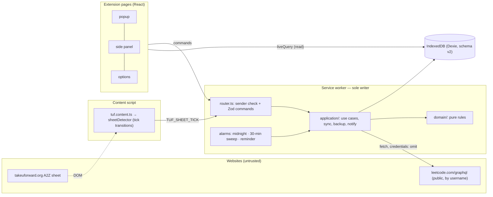

# Architecture

## Layers

| Layer        | Folder                           | Rule                                                                                                                                                                                   |
| ------------ | -------------------------------- | -------------------------------------------------------------------------------------------------------------------------------------------------------------------------------------- |
| Domain       | `src/domain`                     | Pure TS. No browser APIs, Dexie, React or clock (ESLint-enforced). Money, calendar, plans, penalty fold, counting, identity, streaks, analytics, notification planning.                |
| Application  | `src/application`                | Use cases over Dexie: start, record (single/batch), finalize/recompute, mapping, LeetCode sync, Striver intake, settings, notifications, backup/restore, read model (`loadDashboard`). |
| Persistence  | `src/persistence`                | Dexie schema versions + migrations, record types.                                                                                                                                      |
| Platform     | `src/platform`, `src/background` | Clock (e2e override), side panel, router, alarms, notifier, badge.                                                                                                                     |
| Integrations | `src/integrations`               | LeetCode GraphQL client, Striver sheet detector. Parse only; never write.                                                                                                              |
| UI           | `src/ui`                         | React views; formatting and copy only. No rules.                                                                                                                                       |

## Key flows

- **Write path:** page/content script → `runtime.sendMessage` → `handleCommand` (sender origin + Zod) → use case → Dexie transaction → `afterChange` (badge, notifications, next alarm).
- **Day close:** derived, never accumulated. `recomputeAll(now)` re-runs the fold for every closed day; a day is rewritten only if its `inputsKey` changed (new ledger row + audit). Called on every completion, alarm and worker wake.
- **Read path:** `loadDashboard(db, now)` derives everything from stored facts, so screens are correct even before the worker finalizes.

Decisions: `docs/decisions/` (ADR-0001 … 0013).
