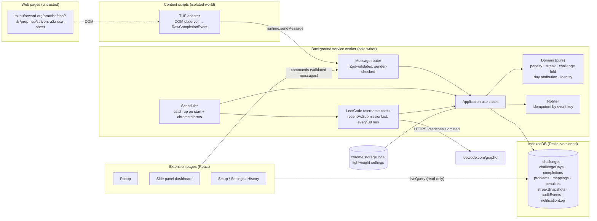
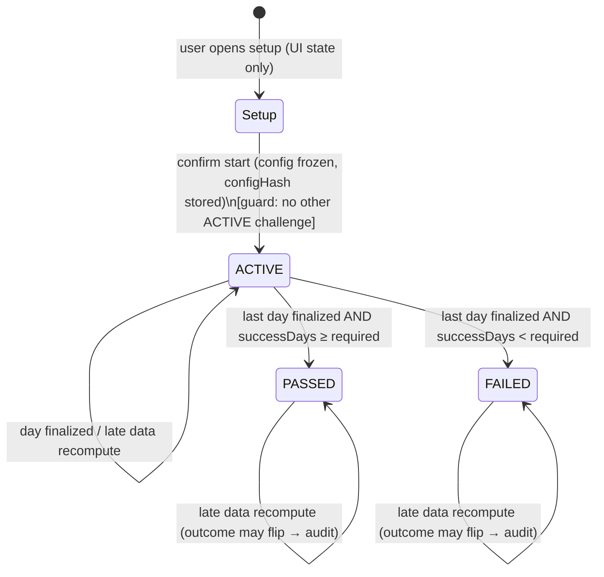
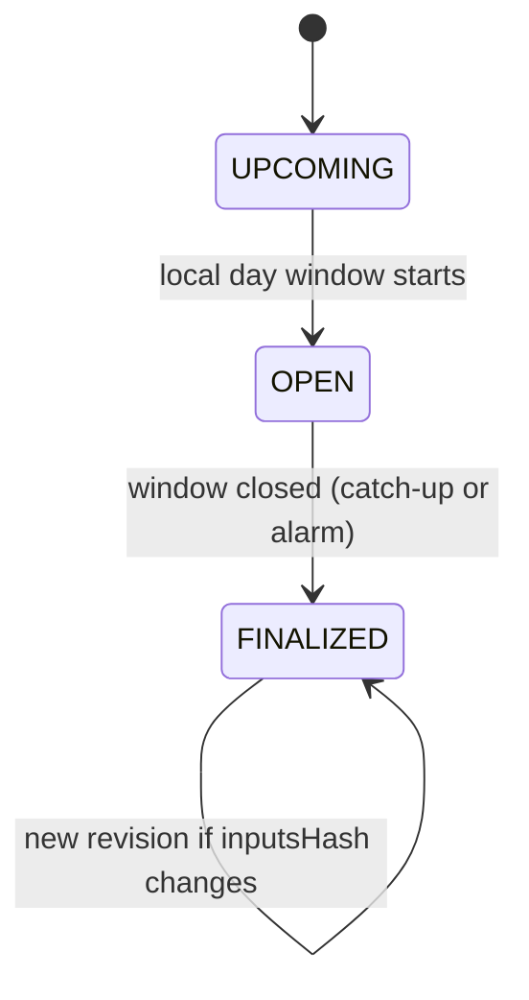

# DSA Discipline — Phase 0 Proposal (Discovery & Planning)

Status: **DRAFT, awaiting owner approval.** No application code has been written.
Date: 2026-11-16 · Author: Claude (Principal Engineer role)

Each claim is tagged:

- **[VERIFIED]**: checked during Phase 0, against official docs, the npm registry, or the live website (the date and method are stated).
- **[ASSUMPTION]**: a technical assumption that still needs to be tested.
- **[QUESTION]**: unresolved; needs an owner decision (collected in §N).
- **[PROPOSAL]**: a proposed implementation decision.

---

## 0. Repository inspection

**[VERIFIED]** `D:\DSMOT` holds only an empty `git init`: a `.git/` folder with default hooks, no commits, no refs under `heads/`, and no working-tree files. Nothing existed before this phase, so nothing was overwritten.

Files created in Phase 0 (documentation only):
`CLAUDE.md`, `README.md`, `PROJECT_STATUS.md`, `docs/PRD.md`, `docs/PHASE_0_PROPOSAL.md`, and the `docs/decisions/0001…0006` records.
`ARCHITECTURE.md`, `DOMAIN_MODEL.md`, `DATA_MODEL.md`, `INTEGRATIONS.md`, `SECURITY.md`, `TESTING.md` and `ROADMAP.md` will be split out of this proposal once you approve it. Splitting them now would create seven copies of the same content to keep in sync while it is still under review.

---

## Key findings that change the brief's assumptions

1. **The Striver A2Z sheet is no longer a list of LeetCode/GFG links.** [VERIFIED, live site, 2026-11-16]
   - The old URL now redirects to `takeuforward.org/prep-hub/strivers-a2z-dsa-sheet`.
   - The sheet lists **495 problems**.
   - Every problem row links to TUF's **own judge** at `takeuforward.org/practice/dsa/<slug>`, which has Run Code, Submit Code and a Submissions tab.
   - No LeetCode links appeared in the sheet DOM (checked in the Sorting module).
   - Consequence: cross-platform deduplication cannot rely on links. It needs a curated mapping.
   - Consequence: Striver _can_ in principle produce automatically verified submissions, through TUF's own judge.
2. **LeetCode's Terms of Service forbid crawling and scraping.** [VERIFIED, leetcode.com/terms]
   - So the proposed design makes **zero extra network requests** to LeetCode. It only passively observes what the user's own tab already shows.
3. **TypeScript 7.0.2 is the current "latest" release, but typescript-eslint 8.72.2 only supports TypeScript `<6.1.0`.** [VERIFIED, npm registry]
   - Proposal: pin TypeScript 6.0.3 for now (ADR-0002).
4. **Chrome alarms can be delayed and may be lost on browser restart** (except with `persistAcrossSessions`, Chrome 150+). [VERIFIED, Chrome alarms reference]
   - So day finalization is driven by **wall-clock catch-up on every service-worker start**, not by trusting that an alarm fired.

---

## Owner decisions — 2026-11-16 (these supersede anything below that conflicts)

Recorded in `docs/decisions/0007-owner-decisions-2026-11-16.md`.

| #     | Decision                                                                                                                                                                                                               |
| ----- | ---------------------------------------------------------------------------------------------------------------------------------------------------------------------------------------------------------------------- |
| Q1    | **A day is a calendar day, 00:00–24:00 Asia/Kolkata.** The configurable "daily deadline" is **removed**. A separate "remind me at" time is used for notifications only.                                                |
| Q2    | **Re-solving an old problem counts again.** Uniqueness applies **per day**: the same problem twice on one day counts once; on different days it counts on each day.                                                    |
| Q3    | **No manual backdating.** A manual entry belongs to the day it is marked. Streaks update automatically from solves.                                                                                                    |
| Q3+   | **The heatmap and streak are coloured by intensity**: light green to deep green according to the number of problems solved that day.                                                                                   |
| Q4/Q5 | **A challenge cannot be quit.** It always runs to its end. The `ABANDONED` state is removed.                                                                                                                           |
| Q6    | **Day 1 is the day the challenge is created**; day 2 starts at the next midnight.                                                                                                                                      |
| Q7    | **Ticking a problem on the Striver sheet counts toward the target.** It is auto-detected from the sheet when possible, with manual entry as the fallback. It is labelled "Sheet marked complete" and never "Accepted". |
| Q8/Q9 | **LeetCode is connected by username.** The extension reads your public recent-accepted list (no password, no cookies) and determines what you solved today itself. **No 495-problem mapping dataset.**                 |
| Plans | **Three challenge plans: 7, 15 and 30 days.** 15-day: **3 grace days / 12 successful days required**.                                                                                                                  |
| Q10   | Outside a challenge, a streak day requires the **same target as the most recent challenge**. Before any challenge exists there is no streak.                                                                           |
| Q12   | **Timezone is fixed to Asia/Kolkata.** It is stored per challenge for safety but not user-editable.                                                                                                                    |
| Q11   | Not answered explicitly. Default: completion rates use **rolling 7 and 30 days**.                                                                                                                                      |

---

## A. Product requirements summary

DSA Discipline is a **personal, local-first MV3 Chrome extension**. It turns daily DSA practice into a commitment device.

- **One unified daily target**, fed by LeetCode and Striver A2Z (TUF). Only genuine, unique completions count. Every completion records its source, title, URL, source timestamp and verification type (auto / manual / awaiting / duplicate-excluded).
- **Challenges**:

  | Challenge | Grace days (zero-activity) | Required full-target days |
  | --------- | -------------------------- | ------------------------- |
  | 7-day     | 2                          | ≥ 5                       |
  | 30-day    | 5                          | ≥ 25                      |
  - Configuration is frozen once a challenge starts. Challenges cannot overlap.
  - Configurable before start: target, starting penalty (₹20), increment (₹20), deadline (23:59) and timezone (Asia/Kolkata).

- **Virtual penalty engine**:
  - Integer paise and round-half-up.
  - A partial day is always penalized proportionally.
  - A zero-activity day consumes a grace day while any remain; after that it takes the full rate.
  - The rate escalates only on penalized days.
  - The penalty is purely an analytics figure. A persistent disclaimer says so, and there is no money functionality anywhere.
- **Streaks**:
  - Kept independent of challenge outcome.
  - Only full-target days extend a streak. Partial days, grace days and penalized zero days all break it.
- **Reliability**:
  - UTC storage. Calendar dates come from the challenge's IANA timezone.
  - Day attribution uses the source timestamp.
  - Late data triggers deterministic recomputation, with an audit trail and no double charging.
  - Nothing depends on the service worker staying alive.
- **Local data**: IndexedDB with a versioned schema and migrations, JSON export and validated import, and no backend, accounts or sync.
- **UI**:
  - Popup, side panel dashboard, setup, history (heatmap and ledger), settings, and integrations health.
  - Premium dark-first look: deep neutrals, emerald accent, no fake data.
- **Quality**:
  - Strict TypeScript and Zod at boundaries.
  - Pure domain logic.
  - Unit, integration and end-to-end tests.
  - Minimum permissions.

---

## B. Proposed architecture

[PROPOSAL] Layered, with dependencies pointing inward. The **domain is pure TypeScript**: no `chrome.*`, no Dexie, no React and no `Date.now()`. Time is passed in as data.

| Layer           | Responsibility                                                                                                                                                     | May import                                                        |
| --------------- | ------------------------------------------------------------------------------------------------------------------------------------------------------------------ | ----------------------------------------------------------------- |
| `domain/`       | Penalty, streak, challenge evaluation, day attribution, dedup identity, rounding, money (paise). Pure functions over plain data.                                   | nothing outside `domain/`, plus `@date-fns/tz` for timezone maths |
| `application/`  | Use cases: `recordCompletion`, `markManual`, `finalizeDueDays`, `recomputeChallenge`, `startChallenge`, `exportData`, `importData`. Orchestrates domain and ports. | `domain/`, port interfaces                                        |
| `persistence/`  | Dexie database, schema versions, migrations, repositories implementing the ports, backup codec.                                                                    | `domain/` types, `dexie`, `zod`                                   |
| `platform/`     | Chrome adapters: alarms, notifications, storage.local (settings), runtime messaging, side panel, clock.                                                            | `chrome.*`                                                        |
| `integrations/` | LeetCode and TUF content-script adapters. They only parse the DOM into `RawCompletionEvent` and send a validated message. They **never** touch the database.       | `zod`, message schema                                             |
| `ui/`           | React popup, side panel and options pages. Reads through a query layer and writes through messages to the service worker.                                          | `application/` read models, messaging client                      |

**Single writer.** Only the background service worker writes to IndexedDB. Extension pages share the extension origin, so the UI _reads_ IndexedDB directly (Dexie `liveQuery`) for instant, reactive views. All _writes_ go through validated runtime messages to the service worker.

Why: one place enforces idempotency and recomputation, and multiple open pages cannot race to write.

**Event-sourced completions, derived results.** Raw `ProblemCompletion` records are append-only facts with revisions for status upgrades. `ChallengeDay` results and `PenaltyRecord`s are **derived** by re-running a pure fold over a challenge's completions.

- Recomputation is deterministic and idempotent.
- Double charging is impossible by construction: a day's penalty is a function of its inputs, never an accumulator that gets incremented.

**Time driver.** Every service-worker start (`onStartup`, `onInstalled`, the first message, `onAlarm`) runs `finalizeDueDays(now)`. This finalizes every challenge day whose window has closed but has no current result.

- Alarms only make this happen _sooner_ and fire reminders.
- Missed alarms, a closed Chrome, or a powered-off computer all self-heal on the next start.

---

## C. Architecture diagram



---

## D. Proposed project folder structure

```text
dsa-discipline/
├─ CLAUDE.md  README.md  PROJECT_STATUS.md
├─ wxt.config.ts  tsconfig.json  eslint.config.js  .prettierrc
├─ vitest.config.ts  playwright.config.ts
├─ .github/workflows/ci.yml
├─ docs/  (PRD, ARCHITECTURE, DOMAIN_MODEL, DATA_MODEL, INTEGRATIONS,
│          SECURITY, TESTING, ROADMAP, decisions/)
├─ src/
│  ├─ entrypoints/                 # WXT file-based entrypoints (thin)
│  │  ├─ background.ts             # wires router, scheduler, catch-up
│  │  │  ├─ tuf.content.ts            # matches https://takeuforward.org/*
│  │  ├─ popup/                    # index.html + main.tsx
│  │  ├─ sidepanel/
│  │  └─ options/                  # setup, settings, history, integrations
│  ├─ domain/
│  │  ├─ money.ts                  # Paise branded type, roundHalfUp
│  │  ├─ calendar.ts               # dayKeyFor(instant, tz, deadline)
│  │  ├─ challenge/                # config, rules (7/30), evaluate (fold), outcome
│  │  ├─ penalty/                  # rate, dayPenalty
│  │  ├─ streak/
│  │  ├─ completion/               # counting rules, verification upgrade
│  │  └─ identity/                 # canonical keys, mapping resolution
│  ├─ application/                 # use cases + ports (interfaces)
│  ├─ persistence/
│  │  ├─ db.ts  schema/v1.ts  migrations/
│  │  ├─ repositories/
│  │  └─ backup/                   # export, import, zod schemas, checksum
│  ├─ platform/                    # chrome adapters (alarms, notify, msg, clock)
│  ├─ integrations/
│  │  ├─ shared/                   # RawCompletionEvent schema, health
│  │  ├─ leetcode/                 # username query client + zod response schema
│  │  └─ tuf/
│  ├─ messaging/                   # zod message contracts (single source)
│  ├─ ui/
│  │  ├─ design-system/            # tokens, primitives
│  │  ├─ features/                 # today, challenge, history, settings…
│  │  └─ hooks/                    # useLiveQuery wrappers
│  └─ data/problem-map.v1.json     # curated TUF↔LeetCode mapping
└─ tests/
   ├─ unit/                        # mirrors src/domain
   ├─ integration/                 # fake-indexeddb, message router, migrations
   ├─ fixtures/                    # saved DOM snapshots of LC/TUF pages
   └─ e2e/                         # Playwright with unpacked extension
```

---

## E. Domain model and database schema

### Core domain types (conceptual)

- `Paise`: branded integer. All money is stored as `Paise`, and the UI formats it as `₹x.yy`.
- `DayKey`: `"YYYY-MM-DD"` in the challenge's timezone.
- `CanonicalKey`: e.g. `lc:two-sum` or `tuf:selection-sort`. A `CanonicalProblem` groups one or more source keys.
- `VerificationType`: `AUTO_VERIFIED | MANUAL | AWAITING_VERIFICATION | DUPLICATE_EXCLUDED`.
- `SourceEvidence`: `LC_ACCEPTED_DOM | LC_ACCEPTED_RESPONSE (if ADR-0004 approved) | TUF_SUBMISSION_ACCEPTED | TUF_SHEET_CHECKBOX | USER_MANUAL`.
  - `TUF_SHEET_CHECKBOX` is **never** presented as an Accepted submission.
- `DayOutcome`: `SUCCESS | PARTIAL_PENALIZED | ZERO_GRACE | ZERO_PENALIZED`.
- `ChallengeStatus`: `ACTIVE | PASSED | FAILED | ABANDONED`. A setup draft is UI state only and is not persisted as a challenge.

### Dexie schema v1

The `&` prefix marks a unique index, `++` marks auto-increment, and `[a+b]` marks a compound index.

| Table             | Primary key / indexes                                                                 | Key fields                                                                                                                                                                                                                                       |
| ----------------- | ------------------------------------------------------------------------------------- | ------------------------------------------------------------------------------------------------------------------------------------------------------------------------------------------------------------------------------------------------ |
| `challenges`      | `id`, `status`, `startDayKey`                                                         | `id`, `kind (7\|15\|30)`, `config` (frozen: target, startPaise, incPaise, tz = Asia/Kolkata, graceAllowance, requiredSuccess, countManual; day = 00:00–24:00), `startedAtUtc`, `startDayKey`, `endDayKey`, `status`, `configHash`, `endedAtUtc?` |
| `challengeDays`   | `[challengeId+dayKey]`, `challengeId`                                                 | `dayIndex`, `outcome?`, `countedProblemKeys[]`, `countedCount`, `graceUsedAfter`, `penalizedIndex?`, `ratePaise?`, `penaltyPaise`, `inputsHash`, `finalizedAtUtc?`, `revision`                                                                   |
| `problems`        | `&canonicalKey`                                                                       | `title`, `difficulty?`, `sourceKeys[]`                                                                                                                                                                                                           |
| `sourceProblems`  | `&sourceKey`, `platform`                                                              | `platform`, `sourceSlug`, `sourceNumericId?`, `title`, `url`, `difficulty?`, `canonicalKey`                                                                                                                                                      |
| `completions`     | `id`, `sourceKey`, `canonicalKey`, `sourceTimestampUtc`, `[canonicalKey+dayKeyLocal]` | `platform`, `evidence`, `verification`, `sourceTimestampUtc`, `discoveredAtUtc`, `externalSubmissionId?`, `supersededBy?`, `rawRef`                                                                                                              |
| `mappings`        | `id`, `&[sourceKeyA+sourceKeyB]`                                                      | `decision (SAME\|DIFFERENT)`, `origin (DATASET\|USER)`, `datasetVersion?`, `decidedAtUtc`                                                                                                                                                        |
| `penaltyRecords`  | `id`, `[challengeId+dayKey]`, `challengeId`                                           | `revision`, `ratePaise`, `penaltyPaise`, `reason`, `supersedesId?`. Append-only ledger; the current value is the highest revision.                                                                                                               |
| `streakSnapshots` | `&asOfDayKey`                                                                         | `current`, `longest`, `totals`. A cache that can be rebuilt.                                                                                                                                                                                     |
| `auditEvents`     | `++seq`, `type`, `atUtc`                                                              | `type`, `payload`, `atUtc`. Append-only.                                                                                                                                                                                                         |
| `notificationLog` | `&eventKey`                                                                           | `eventKey` (e.g. `deadline:ch1:2026-11-20`), `sentAtUtc`. Guarantees idempotency.                                                                                                                                                                |
| `meta`            | `&key`                                                                                | `schemaVersion`, `installId`, `lastCatchUpUtc`                                                                                                                                                                                                   |

Settings go in `chrome.storage.local`: theme, reminder times, notification toggles, integration toggles and the manual-counts default. `NotificationSetting` and `IntegrationSetting` live there, validated by Zod.

**Manual completions** are `completions` rows with `evidence=USER_MANUAL`, rather than a separate table. This keeps the "manual → verified upgrade" a status change on one fact. A later auto-verified completion for the same canonical problem and day sets `supersededBy` on the manual row, so it is counted once.

**Migrations.** Every Dexie version bump ships an `upgrade()` function plus a test with fixtures from the previous version. Import runs incoming data through the same migration chain.

**`unlimitedStorage`** is not requested. Data volume is tiny: about 500 problems and a few thousand completions per year.

---

## F. Challenge state machine



Challenge days follow their own lifecycle:



A finalized outcome is one of: `SUCCESS` (count ≥ target), `PARTIAL_PENALIZED` (0 < count < target), `ZERO_GRACE` (count = 0 and grace remains), or `ZERO_PENALIZED` (count = 0 and grace is exhausted).

**Evaluation is a fold.** `evaluate(config, countsByDayIndex[]) → DayResult[]`. It walks days in order and carries `graceUsed` and `penalizedIndex`.

- Grace use and the penalty index depend on _earlier_ days.
- So any change to day _k_ recomputes days _k…n_. Each day's `inputsHash` (its counted keys plus the carried state) decides whether a new `penaltyRecords` revision and an `AuditEvent{type: DAY_REVISED}` are written.
- Re-running with identical inputs writes nothing. Finalization is idempotent.

[PROPOSAL] An early "can no longer pass" indicator is shown once `successDays + remainingDays < required`, but the challenge still runs to its end (see Q4).

---

## G. Penalty calculation examples

**Formulas**

- `rate(i) = startPaise + (i − 1) × incPaise`, where _i_ = 1, 2, 3… counts penalized days only.
- `penaltyPaise = roundHalfUp(rate × shortfall / target)`, computed in integers as `(2·rate·shortfall + target) div (2·target)`.

**Target 4, start ₹20, increment ₹20** (every value from the brief, verified):

| Penalized index → rate | 3/4    | 2/4    | 1/4    | 0/4 (grace exhausted) |
| ---------------------- | ------ | ------ | ------ | --------------------- |
| 1 → ₹20 (2000 p)       | ₹5.00  | ₹10.00 | ₹15.00 | ₹20.00                |
| 2 → ₹40 (4000 p)       | ₹10.00 | ₹20.00 | ₹30.00 | ₹40.00                |
| 3 → ₹60                | ₹15.00 | ₹30.00 | ₹45.00 | ₹60.00                |
| 4 → ₹80                | ₹20.00 | ₹40.00 | ₹60.00 | ₹80.00                |

**Rounding cases**

| Case                                       | Calculation                                 | Result                             |
| ------------------------------------------ | ------------------------------------------- | ---------------------------------- |
| Target 3, ₹20, 2/3 done                    | 2000 × 1 / 3 = 666.67 p                     | 667 p = **₹6.67**                  |
| Target 3, ₹20, 1/3 done                    | 2000 × 2 / 3 = 1333.33 p                    | **₹13.33**                         |
| Exact half (start ₹25, target 8, 7/8 done) | 2500 × 1 / 8 = 312.5 p                      | rounds **up** to 313 p = **₹3.13** |
| Target 1                                   | either 1/1 → ₹0, or 0/1 → grace / full rate | no partial possible                |

**Worked 7-day challenge** (target 4, ₹20/₹20, grace 2, needs 5 successes):

| Day | Done | Outcome        | Grace used | Pen. idx | Rate | Penalty | Streak |
| --- | ---- | -------------- | ---------- | -------- | ---- | ------- | ------ |
| 1   | 4/4  | SUCCESS        | 0          | –        | –    | ₹0      | 1      |
| 2   | 3/4  | PARTIAL        | 0          | 1        | ₹20  | ₹5      | 0      |
| 3   | 0/4  | ZERO_GRACE     | 1          | –        | –    | ₹0      | 0      |
| 4   | 0/4  | ZERO_GRACE     | 2          | –        | –    | ₹0      | 0      |
| 5   | 2/4  | PARTIAL        | 2          | 2        | ₹40  | ₹20     | 0      |
| 6   | 0/4  | ZERO_PENALIZED | 2          | 3        | ₹60  | ₹60     | 0      |
| 7   | 4/4  | SUCCESS        | 2          | –        | –    | ₹0      | 1      |

Total: **₹85 virtual**. Successful days: 2 of the required 5, so the challenge **FAILED**. Grace days protected days 3 and 4 from penalty, but did not make them successes.

**Late-data example.** A LeetCode Accepted on day 2 arrives late (for example, it was observed only on day 3).

- Day 2 becomes 4/4 SUCCESS, so penalized index 1 moves to day 5: ₹20 × 2/4 = ₹10.
- Day 6 becomes index 2: ₹40.
- New total: ₹50.
- Days 2, 5 and 6 each get a new penalty revision and an audit event. Nothing is charged twice.

---

## H. LeetCode integration feasibility

**Verified on leetcode.com/problems/two-sum, 2026-11-16, signed out:**

- **[VERIFIED]** The problem page embeds `#__NEXT_DATA__` on full page load. Its `question` object contains `questionId`, `questionFrontendId`, `titleSlug`, `title` and `difficulty`.
  - This gives a canonical ID (`titleSlug`) and the difficulty without any extra request.
  - Single-page navigation may leave it stale, so the adapter cross-checks it against the URL slug.
- **[VERIFIED]** Stable test hooks are present: `data-e2e-locator="console-submit-button"` and `"question-title"`. These are more durable than the hashed CSS classes.
- **[VERIFIED]** The page talks to an internal `POST /graphql/` endpoint. It is undocumented and not a supported public API.
- **[VERIFIED]** The ToS forbids "crawling, scraping or spidering" the Service.
- **[NOT VERIFIED]** The DOM of an _Accepted_ result. Checking it requires signing in and submitting real code, which I did not do. Public projects report a result panel and a `/submissions/detail/<id>/check/` polling endpoint. Treat both as unconfirmed.

**Options assessed**

| Option                                                                           | Mechanism                                                                                                                                                                                                                                                                                                | Verdict                                                                                                                                                                                                                                                                                                                                                                                                                                                                                                                                                                                                                                                                                                                                                                                                                                                                                                                                                                                                                                                                                                                                                                                                                                                                                      |
| -------------------------------------------------------------------------------- | -------------------------------------------------------------------------------------------------------------------------------------------------------------------------------------------------------------------------------------------------------------------------------------------------------- | -------------------------------------------------------------------------------------------------------------------------------------------------------------------------------------------------------------------------------------------------------------------------------------------------------------------------------------------------------------------------------------------------------------------------------------------------------------------------------------------------------------------------------------------------------------------------------------------------------------------------------------------------------------------------------------------------------------------------------------------------------------------------------------------------------------------------------------------------------------------------------------------------------------------------------------------------------------------------------------------------------------------------------------------------------------------------------------------------------------------------------------------------------------------------------------------------------------------------------------------------------------------------------------------- |
| **L0. Username-based recent-accepted list (OWNER-APPROVED PRIMARY, 2026-11-16)** | The service worker POSTs `recentAcSubmissionList(username, limit)` to `https://leetcode.com/graphql/` with `credentials: "omit"`. It returns `title`, `titleSlug` and a **server `timestamp`** per accepted submission. The extension keeps only entries whose timestamp falls on a tracked Kolkata day. | **Primary.** It works without the LeetCode tab open and on submissions made from any device, and provides the real source timestamp. **Policy assessment:** this is an undocumented internal GraphQL query, so automated access sits in tension with the ToS anti-crawling clause. Mitigations: personal use, your own public data only, no credentials, at most 1 request per 30 min plus popup-open (debounced to 1 per 2 min), and backoff on errors or 429. **Owner simplification:** it only determines which problems were solved on that day; nothing else. **Limits:** only about the last 20 accepted submissions are returned (the 20-item cap is reported by third parties and unverified), so a day with more than 20 accepted submissions can be undercounted (shown in the UI). If the profile is private or the query changes, the integration goes Degraded and manual entry still works. **[VERIFIED 2026-11-16 on the owner's profile]** 200 OK without credentials; `timestamp` is a string of Unix seconds; the list is **capped at ~10 entries** (asked for 50, got 10, profile has 57 solved). Data is only missed if more than 10 accepted happen within one 30-minute window (accepted by the owner). Same-day detection is still to be confirmed with a real solve. |
| **L1. Passive DOM observation**                                                  | Isolated-world content script. A `MutationObserver` watches for the submission result appearing after the submit button is clicked, and reads "Accepted", the slug and the submission ID from the URL or panel.                                                                                          | **Dropped (owner decision 2026-11-16).** No LeetCode content script at all.                                                                                                                                                                                                                                                                                                                                                                                                                                                                                                                                                                                                                                                                                                                                                                                                                                                                                                                                                                                                                                                                                                                                                                                                                  |
| **L2. Passive response observation**                                             | A MAIN-world script reads the JSON of the `check` response _that the page itself fetched_ (status, question ID, finish time).                                                                                                                                                                            | More precise, because it includes the server's finish timestamp. But it reads an undocumented private endpoint, which the brief says needs explicit assessment. **[QUESTION Q9]** It would be opt-in and off by default (ADR-0004).                                                                                                                                                                                                                                                                                                                                                                                                                                                                                                                                                                                                                                                                                                                                                                                                                                                                                                                                                                                                                                                          |
| ~~L3~~                                                                           | (Superseded by L0 after the owner's decision. The earlier assumption that it "only works while signed in" was wrong: the recent-accepted list is public profile data.)                                                                                                                                   | –                                                                                                                                                                                                                                                                                                                                                                                                                                                                                                                                                                                                                                                                                                                                                                                                                                                                                                                                                                                                                                                                                                                                                                                                                                                                                            |
| L4. Reading session cookies or tokens                                            | –                                                                                                                                                                                                                                                                                                        | **Rejected** by the brief.                                                                                                                                                                                                                                                                                                                                                                                                                                                                                                                                                                                                                                                                                                                                                                                                                                                                                                                                                                                                                                                                                                                                                                                                                                                                   |

**Limitations to show in the UI**

- Auto-tracking works only when the user submits in a Chrome tab where the extension is active and signed in to LeetCode.
- Submissions made on mobile or other devices are not detected; use manual entry for those.
- Under L1 the source timestamp is the moment the extension _observed_ "Accepted", typically seconds after submission. Late attribution is impossible for missed events, and they become manual.
- The connection indicator shows: **Active** (an adapter heartbeat in the last 7 days and selectors resolved), **Degraded** (the page loaded but selectors were missing, so the UI points to the manual fallback), or **Never seen**.

---

## I. Striver A2Z (TUF) integration feasibility

**Verified on takeuforward.org, 2026-11-16, signed out:**

- **[VERIFIED]** The canonical URL is now `/prep-hub/strivers-a2z-dsa-sheet` (the older URL redirects).
  - Overall progress shows **0 / 495**, with breakdowns 84 / 287 / 109.
  - The page says "Log in/Sign up to track your progress", so **progress persistence requires a TUF account**.
- **[VERIFIED]** Row markup uses stable attributes:
  - `tr[data-row-type="practice"][data-sheet-row-key="practice-947"]`
  - checkbox `button[role="checkbox"][aria-checked][aria-label="Mark Selection Sort complete"]`
  - Class names are **hashed CSS modules** (`sheet-tree-module__lpXZ8G__…`). The adapter must never select by class.
- **[VERIFIED]** Problems link to `/practice/dsa/<slug>` (for example `selection-sort` and `merge-sorting`). That page is TUF's own judge: problem "1031. Selection Sort" with Run Code, Submit Code and a Submissions tab.
- **[VERIFIED]** No official public API or integration was found.
- **[NOT VERIFIED]** TUF's Accepted-verdict DOM after Submit, and how the logged-in checkbox persists. Both need the owner's TUF login.

**Proposed handling**

| Signal                                                          | Evidence label                                                                 | Counts toward the target?                                                   |
| --------------------------------------------------------------- | ------------------------------------------------------------------------------ | --------------------------------------------------------------------------- |
| Accepted verdict on `/practice/dsa/<slug>` (if detectable)      | `TUF_SUBMISSION_ACCEPTED` → AUTO_VERIFIED                                      | Yes                                                                         |
| Sheet checkbox flips `aria-checked` false → true, observed live | `TUF_SHEET_CHECKBOX` → shown as "Sheet marked complete", **never** as Accepted | **[QUESTION Q7]** Proposed: treated like manual (follows the manual toggle) |
| User marks it in the extension                                  | `USER_MANUAL`                                                                  | Yes, by default (setting)                                                   |

**Rules and resilience**

- Checkboxes that are already checked when the page loads are **not** imported as completions (their real completion time is unknown). A live false→true transition is recorded with its observation time.
- If the selectors disappear, the adapter goes into **Degraded** mode: no crash, and manual entry still works.

---

## J. Cross-platform deduplication strategy

**Identity layers**

1. **Source key**: `lc:<titleSlug>` or `tuf:<practiceSlug>`. These are stable per platform and never derived from titles.
2. **Canonical problem**: a group of source keys judged to be the same problem.
3. **Mapping evidence**, in precedence order:
   1. A user decision (`SAME` or `DIFFERENT`). This always wins and is recorded with a timestamp.
   2. The curated dataset `problem-map.v1.json`: TUF slug → LeetCode slug, hand-verified, versioned and shipped with the extension.
   3. Nothing. The two keys stay separate canonical problems.
4. **Title similarity** (normalized Levenshtein or token overlap) only creates a **suggestion**: "Possible duplicate: TUF _Two Sum_ ↔ LC _two-sum_". It never merges anything on its own.

**Counting rule.** On a given challenge day, count `distinct canonicalKey` over non-excluded completions.

- A second completion of the same canonical problem on the same day gets `DUPLICATE_EXCLUDED`, with a pointer to the counted record.
- Whether a problem solved on an earlier day can count again (revision) is **[QUESTION Q2]**.

**When a mapping is resolved later**

- Both source records are preserved.
- The canonical key is reassigned and affected challenges are recomputed through the fold, with audit events.

**Dataset (owner decision Q8).** There is **no curated 495-problem dataset**.

- Cross-platform duplicates are caught through title-similarity _suggestions_ plus a one-tap "same problem / different" decision by the user, which is remembered permanently.
- Until a pair is confirmed, both completions count. The UI shows a "possible duplicate" badge so the uncertainty is visible.

**Revised counting rule (owner decision Q2).** Count `distinct canonicalKey` **per day only**. Solving a problem again on a later day counts again.

**Tests**

- Unit: key normalization, precedence order, a "similar titles, different problems" fixture (for example _Subsets_ vs _Subsets II_), and remap recomputation.
- Integration: same problem from both platforms on one day counts once; a manual entry plus an auto entry for the same problem counts once and is upgraded.

---

## K. Security and permission analysis

| Permission                                                                 | Why it is required                                                                                                                                                                                                                       |
| -------------------------------------------------------------------------- | ---------------------------------------------------------------------------------------------------------------------------------------------------------------------------------------------------------------------------------------- |
| `storage`                                                                  | `chrome.storage.local` for settings                                                                                                                                                                                                      |
| `alarms`                                                                   | Reminders and prompt day finalization. Created with `persistAcrossSessions: true` and re-registered on every startup.                                                                                                                    |
| `notifications`                                                            | Optional reminders. **[ASSUMPTION]** It could be requested as an optional permission when the user enables reminders, which further reduces the install-time warning.                                                                    |
| `sidePanel`                                                                | Full dashboard as a side panel                                                                                                                                                                                                           |
| `host_permissions`: `https://leetcode.com/*`, `https://takeuforward.org/*` | LeetCode: the service worker's username check only (no content script). TUF: content script. They could be narrowed further in the content-script `matches` to `/problems/*`, `/practice/dsa/*` and `/prep-hub/strivers-a2z-dsa-sheet*`. |

**Not requested:** `<all_urls>`, `tabs`, `history`, `cookies`, `webRequest`, `debugger`, `scripting`, `desktopCapture`, `unlimitedStorage`.

**Other controls**

- The content-script CSP stays at the MV3 default. No remote code, `eval` or CDN.
- **Messages:** every runtime message has a Zod schema in `messaging/`. The router checks `sender.id === chrome.runtime.id`. Integration messages must also come from a content script whose `sender.url` matches that adapter's origin.
  - Content scripts can only _propose_ `RawCompletionEvent`s. They cannot query or mutate the database.
  - No `externally_connectable`.
- **DOM is untrusted:** titles and slugs are length-limited and pattern-checked, and the UI renders them as text only, never as HTML.
- **If L2 is approved:** the MAIN-world script must not be trusted. Page scripts can forge `postMessage` calls. Its output is therefore classed as "observed" and still has to pass schema and slug-consistency checks. (This is another reason it is opt-in.)
- **Privacy:** no telemetry, no network calls of our own, and no code or problem statements stored (only metadata).

---

## L. Test strategy

| Level                     | Tooling                                                            | Scope                                                                                                                                                                                                                                                                                                                                                       |
| ------------------------- | ------------------------------------------------------------------ | ----------------------------------------------------------------------------------------------------------------------------------------------------------------------------------------------------------------------------------------------------------------------------------------------------------------------------------------------------------- |
| Unit (TDD, written first) | Vitest                                                             | money and rounding (every §G row), penalty rate, day fold (all four outcomes, grace exhaustion, index escalation), pass/fail thresholds, streaks, `dayKeyFor` (midnight, deadline, DST zone such as `America/New_York`, Asia/Kolkata), identity precedence, manual→verified upgrade                                                                         |
| Property-based            | `fast-check` (proposed; small and justified)                       | fold invariants: total = sum of days; recompute(x) == recompute(recompute(x)); grace days never penalized; penalized days strictly increase the rate                                                                                                                                                                                                        |
| Integration               | Vitest + `fake-indexeddb`                                          | repositories, migrations v0→v1 with fixtures, idempotent finalization (run catch-up twice), late-data recompute and audit, notification idempotency, backup round-trip, corrupt or duplicate backup rejection, message router validation                                                                                                                    |
| Adapter                   | Vitest + jsdom on **saved HTML fixtures** of real LC and TUF pages | parse success, missing selectors → Degraded, layout drift                                                                                                                                                                                                                                                                                                   |
| E2E                       | Playwright + Chromium persistent context with `--load-extension`   | install → onboarding → start challenge → manual completions → full, partial and grace days with an injected clock → challenge end → export and import. **[ASSUMPTION]** Tests run against local fixture pages rather than live LeetCode or TUF, to avoid automated access to their sites and flakiness. Live-site checks are a documented manual checklist. |
| CI                        | GitHub Actions                                                     | typecheck, lint, unit, integration, build, and E2E in headless Chromium                                                                                                                                                                                                                                                                                     |

**Clock injection.** The domain never reads time. Application code receives a `Clock` port, and E2E sets the time through a test-only message that only exists in development builds.

---

## M. Development phases with acceptance criteria

| Phase                      | Deliverables                                                                                                                                                                | Acceptance criteria (all verified, not merely generated)                                                                                                                                                                                          |
| -------------------------- | --------------------------------------------------------------------------------------------------------------------------------------------------------------------------- | ------------------------------------------------------------------------------------------------------------------------------------------------------------------------------------------------------------------------------------------------- |
| **1 Foundation**           | WXT + React + TS strict + Tailwind; manifest with the §K permissions only; popup, side panel and options shells; design tokens; ESLint, Prettier, Vitest, Playwright and CI | `typecheck`, `lint`, `test` and `build` pass locally and in CI. The extension loads unpacked in Chrome with no warnings. A Playwright smoke test opens the popup and side panel. The manifest diff is reviewed.                                   |
| **2 Data & Domain**        | Dexie v1 schema and migrations harness; money, calendar, penalty, fold, streak and identity modules; repositories; catch-up finalizer                                       | Every §G example is a passing test. Property tests pass. A migration fixture test passes. Running catch-up twice changes nothing. Domain coverage is ≥ 95% lines. Domain modules have zero `chrome` or `dexie` imports (enforced by a lint rule). |
| **3 Challenge Experience** | Onboarding, setup with summary and confirmation, frozen config, today view, manual completion, challenge dashboard, history list                                            | E2E: start → manual 4/4 → day rolls (injected clock) → success. Partial and grace paths pass. Config cannot be edited after start (UI and service worker both reject it). A second active challenge is blocked.                                   |
| **4 Integrations**         | LC username check (L0 only), TUF adapter, mapping dataset and resolution UI, health status                                                                                  | Fixture tests pass. **A manual live verification by the owner** on real LC and TUF accounts, recorded in INTEGRATIONS.md with date and result. Duplicate submissions count once. Cross-platform same-problem counts once after mapping.           |
| **5 Accountability**       | Streak dashboard, penalty ledger and trend, analytics, heatmap, notifications, integration page                                                                             | Every metric traces to a query over stored data (no constants). Notification idempotency test passes. Reminders respect settings. The disclaimer is visible on every penalty surface.                                                             |
| **6 Hardening**            | Error recovery, service worker restart tests, backup and restore, accessibility (keyboard, contrast AA), performance, security review, production build                     | E2E for the full §17 list. axe checks pass. Service worker killed mid-flow → state is correct on restart. Corrupt backup is rejected without data loss. Signed-off security checklist. Manual Chrome install verified.                            |

---

## N. Risks and unresolved questions

### Risks

| #   | Risk                                                         | Likelihood / impact          | Mitigation                                                                                                            |
| --- | ------------------------------------------------------------ | ---------------------------- | --------------------------------------------------------------------------------------------------------------------- |
| R1  | LeetCode or TUF DOM changes break auto-detection             | High / Medium                | Selector registry, `data-e2e`/aria-only selectors, Degraded state, manual fallback, fixture tests updated per release |
| R2  | LeetCode Accepted DOM differs from expectations (unverified) | Medium / High                | Phase 4 begins with a live recon session with the owner signed in                                                     |
| R3  | ToS exposure                                                 | Low with L1 / Medium with L2 | No extra requests; L2 opt-in only after a documented decision                                                         |
| R4  | Missed events (other devices, extension disabled)            | Certain / Medium             | Manual entry; clear UI copy; no retroactive import                                                                    |
| R5  | Mapping dataset quality (false merges)                       | Medium / High                | Never auto-merge on titles; hand-verify; user override always wins                                                    |
| R6  | Alarm unreliability across restarts                          | Certain / Low                | Catch-up on every service worker start; alarms are only accelerators                                                  |
| R7  | Manual entries let the user game their own accountability    | Medium / Medium              | No backdating (Q3); a manual-off setting; manual entries always labelled                                              |
| R8  | Toolchain churn (TS 7 vs typescript-eslint, Vite 8)          | Medium / Low                 | Pinned versions, ADR-0002, Renovate later                                                                             |

### Questions for the owner — **RESOLVED 2026-11-16** (see "Owner decisions" at the top; kept below for history)

All resolved; L0 verified against the owner's profile (ADR-0004 rev. 2).

- **Q1. Deadline semantics.**
  - Is a challenge day the window `[00:00, deadline]` in the timezone?
  - What happens to a completion between the deadline and midnight (for example with a deadline of 22:00 and an Accepted at 22:30)?
    - (a) It counts toward nothing.
    - (b) It counts toward the next day.
    - (c) It counts toward the same day.
  - _Proposed: (b), so the day runs from deadline to deadline._ With the 23:59 default the difference is one minute.
- **Q2. Uniqueness scope.** Does "one unique problem cannot count twice" apply per day only, or per challenge? In other words, can re-solving a problem from an earlier day count again?
  - _Proposed: unique per challenge_, which is the stricter, anti-gaming reading.
- **Q3. Manual backdating.** May a manual completion be attributed to a past day, such as forgetting to log yesterday?
  - _Proposed: no._ Manual entries belong to the day they are marked, except before that day is finalized.
- **Q4. Early failure.** When passing becomes impossible, does the challenge end immediately or run to completion?
  - _Proposed: it runs to completion_, so penalties and streaks keep accruing, with a "cannot pass" banner.
- **Q5. Abandoning.** May the user abandon an active challenge?
  - If so, are the remaining days treated as zero-activity days (with penalties) or simply void?
  - _Proposed: allowed with typed confirmation; remaining days void, recorded as ABANDONED._
- **Q6. Start day.** Does day 1 start today (a partial day if started at 21:00) or at the next local midnight?
  - _Proposed: the user chooses; tomorrow by default._
- **Q7. TUF sheet checkbox.** Does a TUF sheet checkbox count toward the daily target?
  - _Proposed: yes, treated like a manual entry._ It follows the manual toggle and is labelled "Sheet marked complete".
- **Q8. Mapping dataset.** Is user-assisted mapping plus a small hand-verified seed acceptable? Or do you want a fuller curated A2Z↔LeetCode dataset (about 495 rows of manual verification work) before Phase 4?
- **Q9. LeetCode L2.** Approve, reject or defer the opt-in passive response observation (ADR-0004)?
- **Q10. Streak outside challenges.** The DSA streak needs a daily target on days with no active challenge.
  - _Proposed:_ a global "default daily target" setting. Streaks count only days where a target applies.
- **Q11. Completion-rate windows.** Should weekly and monthly rates use calendar periods (week starting Monday) or rolling 7 and 30 days?
  - _Proposed: rolling._
- **Q12. Timezone change mid-challenge.** Proposed: a challenge's timezone is frozen. A changed system timezone only affects display, never day attribution.

---

## Selected stack (versions verified against the npm registry, 2026-11-16)

| Package                               | Version                      | Reason                                                                                                                                                                                 |
| ------------------------------------- | ---------------------------- | -------------------------------------------------------------------------------------------------------------------------------------------------------------------------------------- |
| wxt                                   | 0.21.5 (modified 2026-10-26) | Actively maintained MV3 framework on Vite 8: file-based entrypoints, manifest generation, HMR. Plasmo has stalled and CRXJS is lower-level. ADR-0001.                                  |
| @wxt-dev/module-react                 | 1.2.2                        | Official React integration                                                                                                                                                             |
| react                                 | 19.3.1                       | UI                                                                                                                                                                                     |
| typescript                            | **6.0.3** (not 7.0.2)        | typescript-eslint 8.72.2 peer range is `<6.1.0`. ADR-0002.                                                                                                                             |
| vite                                  | 8.3.8 (via WXT)              | –                                                                                                                                                                                      |
| tailwindcss                           | 4.3.5                        | Design tokens through CSS variables, no runtime                                                                                                                                        |
| dexie                                 | 4.4.7                        | Versioned schema and upgrades, compound indexes, `liveQuery`. Hand-rolling these on raw IndexedDB is error-prone. ADR-0003.                                                            |
| zod                                   | 4.6.7                        | Boundary validation: messages, DOM output, backups, settings                                                                                                                           |
| date-fns + @date-fns/tz               | 4.4.0 + 1.5.0                | IANA timezone day boundaries. Small and tree-shakeable. **[ASSUMPTION]** The Temporal API could replace them once confirmed in our Chrome target.                                      |
| vitest                                | 5.1.0                        | Unit and integration tests                                                                                                                                                             |
| fake-indexeddb                        | 6.2.8                        | IndexedDB in Node tests                                                                                                                                                                |
| @testing-library/react                | 16.3.3                       | Component tests                                                                                                                                                                        |
| @playwright/test                      | 1.65.1                       | E2E with the unpacked extension                                                                                                                                                        |
| eslint / typescript-eslint / prettier | 10.15.0 / 8.72.2 / 3.10.1    | Lint and format; import-boundary rules                                                                                                                                                 |
| **Deferred**                          | zustand 5.1.0, shadcn/ui     | Not added until needed. Dexie `liveQuery` plus React state likely covers state needs. shadcn components are copied in individually only if a primitive (dialog, popover) justifies it. |

Node ≥ 22 is required (WXT engine requirement).

---

## Sources

- [LeetCode Terms of Service](https://leetcode.com/terms)
- [chrome.alarms API reference](https://developer.chrome.com/docs/extensions/reference/api/alarms)
- [WXT — How WXT works](https://wxt.dev/guide/resources/how-wxt-works)
- [Plasmo vs WXT vs CRXJS vs Extension.js (2026)](https://merginit.com/blog/23082026-plasmo-vs-wxt-vs-crxjs-extension-js)
- Live inspection: `https://takeuforward.org/prep-hub/strivers-a2z-dsa-sheet`, `https://takeuforward.org/practice/dsa/selection-sort`, `https://leetcode.com/problems/two-sum/` (built-in browser, signed out, 2026-11-16)
- npm registry (`npm view`) for every version listed above
